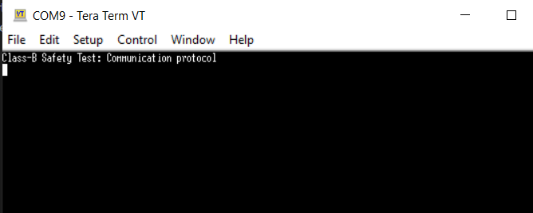

# Class-B Safety Test: Communication protocol

This code example demonstrates the use of the Class-B Safety Test Library to test the communication protocol in embedded systems. The example conducts a communication test by configuring two SCB instances as UART and connecting their TX and RX pins to the corresponding RX and TX pins of other blocks. The objective is to detect any potential data corruption during transit.

[View this README on GitHub.](https://github.com/Infineon/mtb-example-ce241084-safety-communication-test)

[Provide feedback on this code example.](https://cypress.co1.qualtrics.com/jfe/form/SV_1NTns53sK2yiljn?Q_EED=eyJVbmlxdWUgRG9jIElkIjoiQ0UyMzk2ODIiLCJTcGVjIE51bWJlciI6IjAwMi0zOTY4MiIsIkRvYyBUaXRsZSI6IkNsYXNzLUIgU2FmZXR5IFRlc3Q6IENvbW11bmljYXRpb24gcHJvdG9jb2wiLCJyaWQiOiJzZGFrIiwiRG9jIHZlcnNpb24iOiIxLjIuMCIsIkRvYyBMYW5ndWFnZSI6IkVuZ2xpc2giLCJEb2MgRGl2aXNpb24iOiJNQ0QiLCJEb2MgQlUiOiJJQ1ciLCJEb2MgRmFtaWx5IjoiUFNPQyJ9)


## Requirements

- [ModusToolbox&trade;](https://www.infineon.com/modustoolbox) v3.9 or later (tested with v3.9)
- Board support package (BSP) minimum required version: v3.3.0
- Programming language: C
- Associated parts: All PSOC&trade; Control C3 MCUs


## Supported toolchains (make variable 'TOOLCHAIN')

- GNU Arm&reg; Embedded Compiler v14.2.1 (`GCC_ARM`) – Default value of `TOOLCHAIN`
- Arm® Compiler v6.22 (`ARM`)
- IAR C/C++ Compiler v9.70.4 (`IAR`)

## Supported kits (make variable 'TARGET')

- [PSOC&trade; Control C3M5 Evaluation Kit](https://www.infineon.com/KIT_PSC3M5_EVK) (`KIT_PSC3M5_EVK`) – Default value of `TARGET`

## Hardware setup

This example uses the board's default configuration. See the kit user guide to ensure that the board is configured correctly.

Additionally, this code example enables two UART instances in the configurable *design.modus* file; a master and a slave.

To test the communication, external jumper connections are required between UART communication blocks. Here are the connections used for each BSP in this example:


BSP  |  TX-RX |  RX-TX 
---- | ------ | ------ 
KIT_PSC3M5_EVK| P7_2 to P3_3 | P7_1 to P3_2


## Software setup

See the [ModusToolbox&trade; tools package installation guide](https://www.infineon.com/ModusToolboxInstallguide) for information about installing and configuring the tools package.

Install a terminal emulator if you don't have one. Instructions in this document use [Tera Term](https://teratermproject.github.io/index-en.html).

This example requires no additional software or tools.


## Using the code example

### Create the project

The ModusToolbox&trade; tools package provides the Project Creator as both a GUI tool and a command line tool.

<details><summary><b>Use Project Creator GUI</b></summary>

1. Open the Project Creator GUI tool.

   There are several ways to do this, including launching it from the dashboard or from inside the Eclipse IDE. For more details, see the [Project Creator user guide](https://www.infineon.com/ModusToolboxProjectCreator) (locally available at *{ModusToolbox&trade; install directory}/tools_{version}/project-creator/docs/project-creator.pdf*).

2. On the **Choose Board Support Package (BSP)** page, select a kit supported by this code example. See [Supported kits](#supported-kits-make-variable-target).

   > **Note:** To use this code example for a kit not listed here, you may need to update the source files. If the kit does not have the required resources, the application may not work.

3. On the **Select Application** page:

   a. Select the **Applications(s) Root Path** and the **Target IDE**.

   > **Note:** Depending on how you open the Project Creator tool, these fields may be pre-selected for you.

   b.	Select this code example from the list by enabling its check box.

   > **Note:** You can narrow the list of displayed examples by typing in the filter box.

   c. (Optional) Change the suggested **New Application Name** and **New BSP Name**.

   d. Click **Create** to complete the application creation process.

</details>

<details><summary><b>Use Project Creator CLI</b></summary>

The 'project-creator-cli' tool can be used to create applications from a CLI terminal or from within batch files or shell scripts. This tool is available in the *{ModusToolbox&trade; install directory}/tools_{version}/project-creator/* directory.

Use a CLI terminal to invoke the 'project-creator-cli' tool. On Windows, use the command-line 'modus-shell' program provided in the ModusToolbox&trade; installation instead of a standard Windows command-line application. This shell provides access to all ModusToolbox&trade; tools. You can access it by typing "modus-shell" in the search box in the Windows menu. In Linux and macOS, you can use any terminal application.

The following example clones the "[UART communication test](https://github.com/Infineon/mtb-example-ce241084-safety-communication-test)" application with the desired name "CommunicationTest" configured for the *KIT_PSC3M5_EVK* BSP into the specified working directory, *C:/mtb_projects*:

   ```
   project-creator-cli --board-id KIT_PSC3M5_EVK --app-id mtb-example-ce241084-safety-communication-test --user-app-name UARTCommunicationTest --target-dir "C:/mtb_projects"
   ```


The 'project-creator-cli' tool has the following arguments:

Argument | Description | Required/optional
---------|-------------|-----------
`--board-id` | Defined in the <id> field of the [BSP](https://github.com/Infineon?q=bsp-manifest&type=&language=&sort=) manifest | Required
`--app-id`   | Defined in the <id> field of the [CE](https://github.com/Infineon?q=ce-manifest&type=&language=&sort=) manifest | Required
`--target-dir`| Specify the directory in which the application is to be created if you prefer not to use the default current working directory | Optional
`--user-app-name`| Specify the name of the application if you prefer to have a name other than the example's default name | Optional

> **Note:** The project-creator-cli tool uses the `git clone` and `make getlibs` commands to fetch the repository and import the required libraries. For details, see the "Project creator tools" section of the [ModusToolbox&trade; tools package user guide](https://www.infineon.com/ModusToolboxUserGuide) (locally available at {ModusToolbox&trade; install directory}/docs_{version}/mtb_user_guide.pdf).

</details>


### Open the project

After the project has been created, you can open it in your preferred development environment.


<details><summary><b>Eclipse IDE</b></summary>

If you opened the Project Creator tool from the included Eclipse IDE, the project will open in Eclipse automatically.

For more details, see the [Eclipse IDE for ModusToolbox&trade; user guide](https://www.infineon.com/MTBEclipseIDEUserGuide) (locally available at *{ModusToolbox&trade; install directory}/docs_{version}/mt_ide_user_guide.pdf*).

</details>


<details><summary><b>Visual Studio (VS) Code</b></summary>

Launch VS Code manually, and then open the generated *{project-name}.code-workspace* file located in the project directory.

For more details, see the [Visual Studio Code for ModusToolbox&trade; user guide](https://www.infineon.com/MTBVSCodeUserGuide) (locally available at *{ModusToolbox&trade; install directory}/docs_{version}/mt_vscode_user_guide.pdf*).

</details>


<details><summary><b>Command line</b></summary>

If you prefer to use the CLI, open the appropriate terminal, and navigate to the project directory. On Windows, use the command-line 'modus-shell' program; on Linux and macOS, you can use any terminal application. From there, you can run various `make` commands.

For more details, see the [ModusToolbox&trade; tools package user guide](https://www.infineon.com/ModusToolboxUserGuide) (locally available at *{ModusToolbox&trade; install directory}/docs_{version}/mtb_user_guide.pdf*).

</details>


## Operation


1. Connect the board to your PC using the provided USB cable through the KitProg3 USB connector and connect the pins of the kit using the instructions in the [Hardware setup](#hardware-setup) section.

2. Open a terminal program and select the KitProg3 COM port. Set the serial port parameters to 8N1 and 115200 baud.

3. Program the board using one of the following:

   <details><summary><b>Using Eclipse IDE</b></summary>

      1. Select the application project in the Project Explorer.

      2. In the **Quick Panel**, scroll down, and click **\<Application Name> Program (KitProg3_MiniProg4)**.
   </details>


   <details><summary><b>In other IDEs</b></summary>

   Follow the instructions in your preferred IDE.
   </details>


   <details><summary><b>Using CLI</b></summary>

     From the terminal, execute the `make program` command to build and program the application using the default toolchain to the default target. The default toolchain is specified in the application's Makefile but you can override this value manually:
      ```
      make program TOOLCHAIN=<toolchain>
      ```

      Example:
      ```
      make program TOOLCHAIN=GCC_ARM
      ```
   </details>

4. After programming, the application starts automatically. Confirm that **Class-B Safety Test: Communication protocol** is displayed on the UART terminal. 

   **Figure 1. Terminal output on program startup**

   

5. The serial terminal must display the result of the communication protocol test.


## Debugging

You can debug the example to step through the code.


<details><summary><b>In Eclipse IDE</b></summary>

Use the **\<Application Name> Debug (KitProg3_MiniProg4)** configuration in the **Quick Panel**. For details, see the "Program and debug" section in the [Eclipse IDE for ModusToolbox&trade; user guide](https://www.infineon.com/MTBEclipseIDEUserGuide).

</details>


<details><summary><b>In other IDEs</b></summary>

Follow the instructions in your preferred IDE.
</details>

## Design and implementation

The example configures two SCB instances as UART, with the TX and RX pins connected according to the instructions provided in the [Hardware Setup](#hardware-setup) section. The design configurations can be adjusted through the *design.modus* file of the test application.

In this communication protocol, one SCB acts as the master (A) and the other as the slave (B). The master SCB sends a request to the slave SCB, and the slave SCB responds to the request.

The communication between the SCBs follows a packet format, which consists of the following elements:

- `STX` (start of text) - A unique byte (0x02) used to indicate the beginning of the packet.
- `ADDR` (address) - A byte used to identify the intended recipient SCB.
- `DL` (data length) - A byte indicating the length of the data (in bytes) that follows.
- `[Data]` - A sequence of bytes containing the actual data being transferred.
- `CRCH` (CRC High) - The most significant byte of a 16-bit cyclic redundancy check (CRC) code calculated over all bytes from ADDR to the last byte of data.
- `CRCL` (CRC Low) - The least significant byte of the CRC code.

Packet format:
```
<STX><ADDR><DL><[Data bytes length equal DL]><CRCH><CRCL>
```

If any of the bytes in the packet (`ADDR`, `DL`, `[Data]`, or `[CRC]`) is equal to the `STX` byte (0x02), it is replaced by a two-byte sequence `<ESC><STX+1>`. Similarly, if any of these bytes is equal to the ESC byte, it is replaced by a two-byte sequence `<ESC><ESC+1>`. This is done to avoid confusion with the STX and ESC bytes in the data.

The packet format is used for both the request and response packets exchanged between the master and slave SCBs. The master SCB sends a request packet to the slave SCB and waits for the response packet before proceeding with its operation.

The example starts by initializing the BSP configuration and setting up the retarget-io for debug prints. It then configures the UART blocks according to the master and slave configurations defined in the design files. To verify the communication, the example utilizes the API provided by the mtb-stl middleware to handle the request and response as explained earlier in this protocol.

The purpose of the test is to detect any potential data corruption during transmission between the two SCB devices.

## Design and implementation

### Resources and settings

**Table 1. Application resources**

 Resource  |  Alias/object     |    Purpose
 :-------- | :-------------    | :------------
 SCB->UART (PDL) | CYBSP_DUT_UART_MASTER | master resource for communication test 
 SCB->UART (PDL) | CYBSP_DUT_UART_SLAVE | slave resource for communication test 
 UART (HAL_NEXT) | CYBSP_DEBUG_UART   | UART HAL_NEXT object used by Retarget-IO for the Debug UART port

<br>


## Related resources

Resources  | Links
-----------|----------------------------------
Application notes  | [AN238329](https://www.infineon.com/AN238329) – Getting started with PSOC&trade; Control C3 MCU on ModusToolbox&trade; software <br>
Code examples  | [Using ModusToolbox&trade;](https://github.com/Infineon/Code-Examples-for-ModusToolbox-Software) on GitHub
Device documentation | [PSOC&trade; Control C3 MCU datasheet](https://www.infineon.com/cms/en/product/microcontroller/32-bit-psoc-arm-cortex-microcontroller/32-bit-psoc-control-arm-cortex-m33-mcu/psoc-control-c3p/#!documents) <br> [PSOC&trade; Control C3 technical reference manuals](https://www.infineon.com/cms/en/product/microcontroller/32-bit-psoc-arm-cortex-microcontroller/32-bit-psoc-control-arm-cortex-m33-mcu/psoc-control-c3p/#!documents)
Development kits | Select your kits from the [Evaluation board finder](https://www.infineon.com/cms/en/design-support/finder-selection-tools/product-finder/evaluation-board).
Libraries on GitHub  | [mtb-pdl-cat1](https://github.com/Infineon/mtb-pdl-cat1) – Peripheral Driver Library (PDL) <br> [mtb-hal-psc3](https://github.com/Infineon/mtb-hal-psc3) – Hardware Abstraction Layer (HAL) library <br> [retarget-io](https://github.com/Infineon/retarget-io) – Utility library to retarget STDIO messages to a UART port <br> [mtb-stl](https://github.com/Infineon/mtb-stl) - Safety Test Library (STL)
Tools  | [ModusToolbox&trade;](https://www.infineon.com/modustoolbox) – ModusToolbox&trade; software is a collection of easy-to-use libraries and tools enabling rapid development with Infineon MCUs for applications ranging from wireless and cloud-connected systems, edge AI/ML, embedded sense and control, to wired USB connectivity using PSoC&trade; Industrial/IoT MCUs, AIROC&trade; Wi-Fi and Bluetooth&reg; connectivity devices, XMC&trade; Industrial MCUs, and EZ-USB&trade;/EZ-PD&trade; wired connectivity controllers. ModusToolbox&trade; incorporates a comprehensive set of BSPs, HAL, libraries, configuration tools, and provides support for industry-standard IDEs to fast-track your embedded application development.

<br>


## Other resources

Infineon provides a wealth of data at [www.infineon.com](https://www.infineon.com) to help you select the right device, and quickly and effectively integrate it into your design.


## Document history

Document title: *CE241084* - *Class-B Safety Test: Communication protocol*

Version | Description of change 
------- | --------------------- 
1.0.0   | New code example 
1.0.1   | Fix Regression failure
2.0.0   | Migrate CE to KIT_PSC3M5_EVK 3.x 

<br>

All referenced product or service names and trademarks are the property of their respective owners.

The Bluetooth&reg; word mark and logos are registered trademarks owned by Bluetooth SIG, Inc., and any use of such marks by Infineon is under license.


---------------------------------------------------------

(c) 2025-2026, Infineon Technologies AG, or an affiliate of Infineon Technologies
AG. All rights reserved.
This software, associated documentation and materials ("Software") is owned by
Infineon Technologies AG or one of its affiliates ("Infineon") and is protected
by and subject to worldwide patent protection, worldwide copyright laws, and
international treaty provisions. Therefore, you may use this Software only as
provided in the license agreement accompanying the software package from which
you obtained this Software. If no license agreement applies, then any use,
reproduction, modification, translation, or compilation of this Software is
prohibited without the express written permission of Infineon.
<br>
Disclaimer: UNLESS OTHERWISE EXPRESSLY AGREED WITH INFINEON, THIS SOFTWARE IS
PROVIDED AS-IS, WITH NO WARRANTY OF ANY KIND, EXPRESS OR IMPLIED, INCLUDING,
BUT NOT LIMITED TO, ALL WARRANTIES OF NON-INFRINGEMENT OF THIRD-PARTY RIGHTS
AND IMPLIED WARRANTIES SUCH AS WARRANTIES OF FITNESS FOR A SPECIFIC USE/PURPOSE
OR MERCHANTABILITY. Infineon reserves the right to make changes to the Software
without notice. You are responsible for properly designing, programming, and
testing the functionality and safety of your intended application of the
Software, as well as complying with any legal requirements related to its use.
Infineon does not guarantee that the Software will be free from intrusion, data
theft or loss, or other breaches ("Security Breaches"), and Infineon shall have
no liability arising out of any Security Breaches. Unless otherwise explicitly
approved by Infineon, the Software may not be used in any application where a
failure of the Product or any consequences of the use thereof can reasonably be
expected to result in personal injury.
